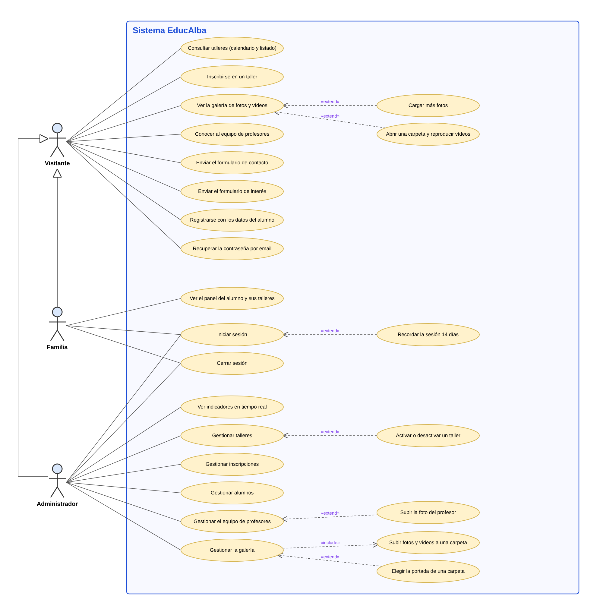
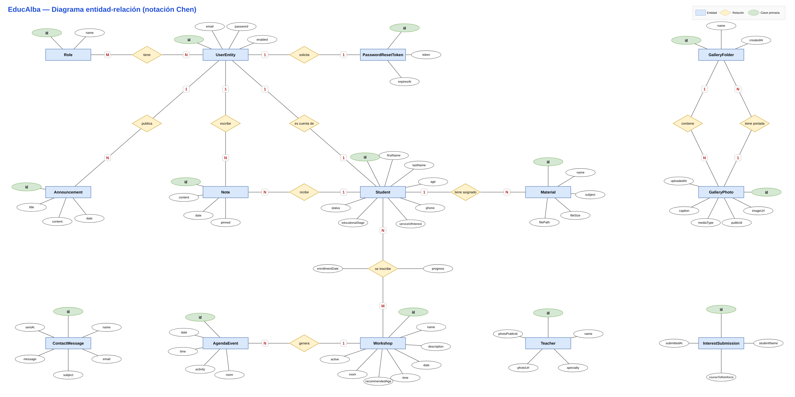
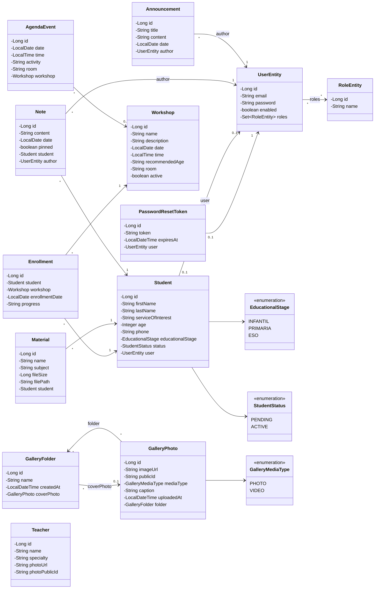
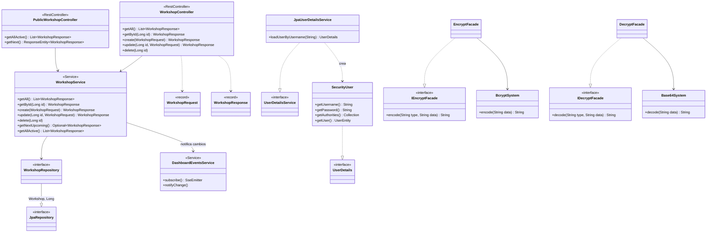
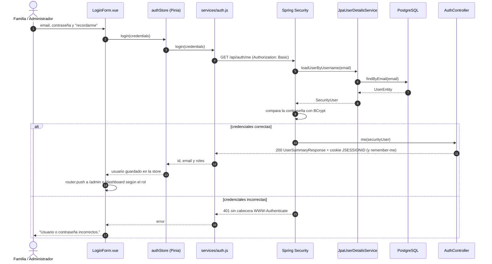
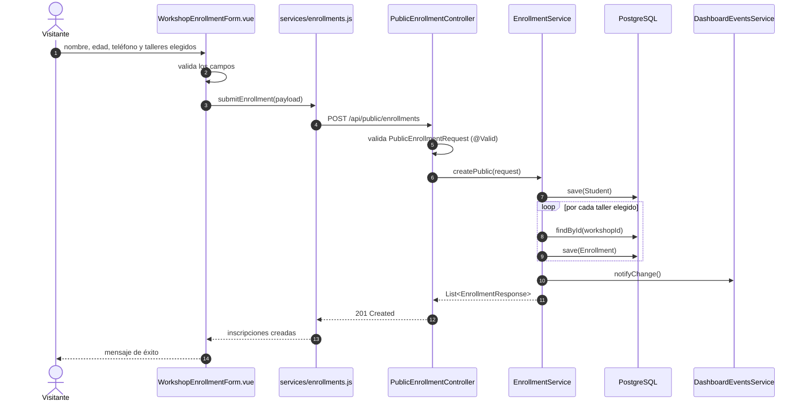
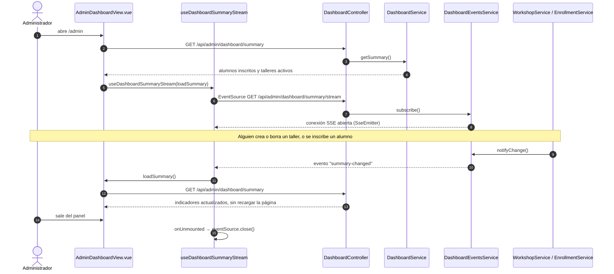
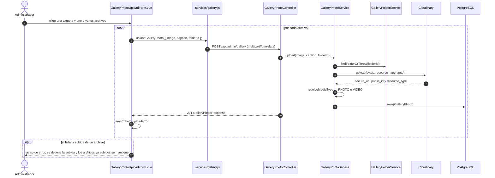
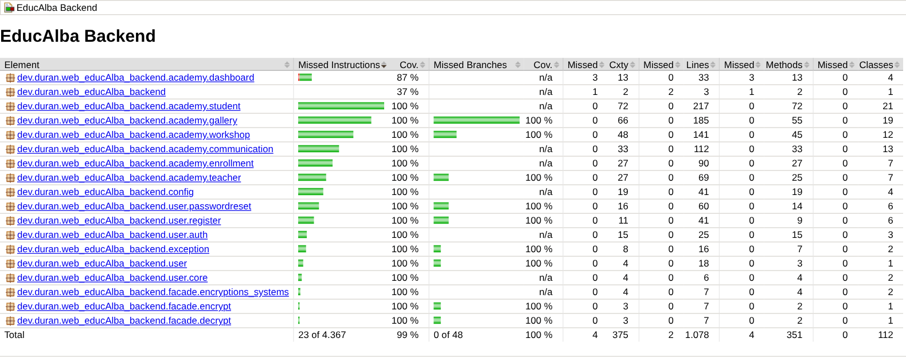

# 🎓 EducAlba · Backend

API REST de **EducAlba**, academia de refuerzo escolar y talleres extraescolares. Gestiona el registro y login de familias y administradores, los talleres y sus inscripciones, los alumnos, sus materiales y notas, los avisos, la galería de fotos y vídeos organizada en carpetas, el equipo de profesores y los formularios públicos de la web.

> 🔗 **Frontend:** [web-educAlba-frontend](https://github.com/duran-ni/web-educAlba-frontend)
> 🎤 **Presentación:** _(enlace pendiente)_

---

## 🔍 Índice

- [Descripción](#-descripción)
- [Tecnologías utilizadas](#-tecnologías-utilizadas)
- [Arquitectura](#-arquitectura)
- [Instalación](#️-instalación)
- [Variables de entorno](#-variables-de-entorno)
- [Uso](#-uso)
- [Endpoints de la API](#-endpoints-de-la-api)
- [Seguridad](#-seguridad)
- [Diagrama de casos de uso](#-diagrama-de-casos-de-uso)
- [Diagrama entidad-relación (Chen)](#-diagrama-entidad-relación-chen)
- [Diagrama de base de datos](#-diagrama-de-base-de-datos)
- [Diagrama de clases](#-diagrama-de-clases)
- [Diagramas de secuencia](#-diagramas-de-secuencia)
- [Tests](#-tests)
- [Integración continua](#-integración-continua)
- [Metodología de trabajo](#-metodología-de-trabajo)
- [Próximos pasos](#-próximos-pasos)
- [Autora](#️-autora)

---

## 📝 Descripción

EducAlba es la web de una academia de refuerzo educativo y talleres para niños de 1 a 12 años y alumnos de ESO. El backend centraliza la información de la academia (alumnos, talleres, inscripciones, galería, profesores y comunicación con las familias) y la expone mediante una **API REST** consumida por el frontend en Vue 3.

La aplicación distingue dos roles:

| Rol              | Quién es                 | Qué puede hacer                                                                                                                       |
| ---------------- | ------------------------ | ------------------------------------------------------------------------------------------------------------------------------------- |
| `ADMINISTRADOR`  | Dirección de la academia | Gestionar talleres, agenda, alumnos, inscripciones, materiales, notas, avisos, galería y profesores. Ver el resumen del dashboard en tiempo real. |
| `ALUMNO_FAMILIA` | Familia que se registra  | Consultar su panel con los datos del alumno y los talleres en los que está inscrito.                                                  |

Cualquier visitante sin cuenta puede ver los talleres, la galería, el equipo de profesores, inscribirse a un taller y enviar el formulario de contacto o de interés.

---

## 💻 Tecnologías utilizadas

| Categoría     | Tecnología                                                     |
| ------------- | -------------------------------------------------------------- |
| Lenguaje      | Java 25                                                        |
| Framework     | Spring Boot 4.1 (Web MVC, Data JPA, Validation, Mail)          |
| Seguridad     | Spring Security (HTTP Basic + sesión por cookie + remember-me) |
| Base de datos | PostgreSQL 17 dockerizada (Docker Compose)                     |
| Multimedia    | Cloudinary (fotos y vídeos de la galería, fotos de profesores) |
| Correo        | Spring Mail + Mailtrap (sandbox de desarrollo)                 |
| Utilidades    | Lombok                                                         |
| Testing       | JUnit 5, MockMvc, Spring Security Test, Testcontainers         |
| Cobertura     | JaCoCo (mínimo exigido 70 %)                                   |
| Build         | Maven (wrapper incluido)                                       |
| CI            | GitHub Actions                                                 |

---

## 🧱 Arquitectura

El código está organizado **por funcionalidad** (_package by feature_): cada carpeta contiene todo lo de un dominio (entidad, repositorio, servicio, controlador, DTOs y excepciones). Dentro de cada funcionalidad se respeta la arquitectura en capas **Controller → Service → Repository**.

```
src/main/java/dev/duran/web_educAlba_backend
├── academy
│   ├── communication   # Avisos, mensajes de contacto, formulario de interés
│   ├── dashboard       # Resumen (KPIs) y eventos en tiempo real (SSE)
│   ├── enrollment      # Inscripciones (admin y formulario público)
│   ├── gallery         # Carpetas, fotos y vídeos de la galería (Cloudinary)
│   ├── student         # Alumnos, materiales, notas y panel de la familia
│   ├── teacher         # Equipo de profesores y sus fotos (Cloudinary)
│   └── workshop        # Talleres y eventos de agenda
├── config              # Seguridad, CORS, Cloudinary, beans
├── exception           # Manejo global de errores (formato único)
├── facade              # Patrón Facade para codificar/cifrar contraseñas
│   ├── decrypt
│   ├── encrypt
│   └── encryptions_systems
└── user
    ├── auth            # /me, SecurityUser, UserDetailsService
    ├── core            # Usuario, roles
    ├── passwordreset   # Recuperación de contraseña por email
    └── register        # Registro de familias
```

**Decisiones técnicas destacadas**

- **DTOs con `record`**: las entidades JPA nunca salen del backend; cada endpoint recibe un `*Request` validado con Bean Validation y devuelve un `*Response`.
- **Manejo global de errores** con `@RestControllerAdvice`: cualquier error responde con el mismo JSON (`timestamp`, `status`, `error`, `message`, `path`).
- **Patrón Facade** para las contraseñas: el frontend envía la contraseña codificada en Base64, `DecryptFacade` la decodifica y `EncryptFacade` la cifra con BCrypt antes de guardarla.
- **Server-Sent Events (SSE)**: el dashboard del administrador recibe un aviso en tiempo real cuando se crea o elimina un taller o se inscribe un alumno, sin tener que recargar.
- **`spring.jpa.open-in-view=false`**: evita consultas ocultas fuera de la transacción y obliga a cargar explícitamente los datos relacionados.
- **Secretos fuera del código**: credenciales de correo, Cloudinary y la clave de remember-me se leen de variables de entorno.
- **Fotos y vídeos con Cloudinary**: se sube con `resource_type: auto` para que Cloudinary detecte si es foto o vídeo, y el tipo se guarda (`PHOTO` / `VIDEO`) para borrarlo después correctamente.
- **Paginación** en la galería pública con `Pageable` de Spring Data: cada respuesta indica `hasMore` para que el frontend sepa si mostrar el botón "cargar más".
- **Subidas de hasta 15 MB** por archivo y por petición (`spring.servlet.multipart.*`), porque el límite por defecto de 1 MB no admitía fotos hechas con el móvil.

---

## 🛠️ Instalación

### Requisitos previos

- Java 25 (JDK)
- Docker Desktop (en ejecución)
- Git

### Pasos

**1.** Clonar el repositorio:

```bash
git clone https://github.com/duran-ni/web-educAlba-backend.git
cd web-educAlba-backend
```

**2.** Configurar las variables de entorno (ver la [tabla de abajo](#-variables-de-entorno)). Sin ellas la aplicación arranca, pero no se envían correos ni se pueden subir fotos y vídeos a la galería ni fotos de profesores.

**3.** Ejecutar la aplicación:

```bash
# Linux / macOS / Git Bash
./mvnw spring-boot:run

# Windows (PowerShell o CMD)
mvnw.cmd spring-boot:run
```

Gracias a `spring-boot-docker-compose`, al arrancar Spring Boot **levanta automáticamente el contenedor de PostgreSQL** definido en `compose.yaml`. Si prefieres levantarlo a mano:

```bash
docker compose up -d
```

**4.** La API queda disponible en `http://localhost:8080/api`.

Al primer arranque se crean automáticamente:

- Los roles `ADMINISTRADOR` y `ALUMNO_FAMILIA` y un usuario administrador inicial (`DataSeeder`).
- Los talleres de ejemplo de octubre y la carpeta de galería por defecto "Nuestra academia" (`data.sql`).

> ⚠️ Las credenciales del administrador inicial están definidas en `DataSeeder` y son solo para desarrollo. En producción deben cambiarse.

---

## 🔐 Variables de entorno

| Variable                | Obligatoria                              | Para qué sirve                                            |
| ----------------------- | ---------------------------------------- | --------------------------------------------------------- |
| `MAIL_USERNAME`         | Para enviar correos                      | Usuario SMTP de Mailtrap                                  |
| `MAIL_PASSWORD`         | Para enviar correos                      | Contraseña SMTP de Mailtrap                               |
| `CLOUDINARY_CLOUD_NAME` | Para galería y profesores                | Nombre de la cuenta de Cloudinary                         |
| `CLOUDINARY_API_KEY`    | Para galería y profesores                | API key de Cloudinary                                     |
| `CLOUDINARY_API_SECRET` | Para galería y profesores                | API secret de Cloudinary                                  |
| `REMEMBER_ME_KEY`       | En producción                            | Clave para firmar la cookie "recordar sesión"             |
| `FRONTEND_BASE_URL`     | No (por defecto `http://localhost:5173`) | URL del frontend para el enlace del email de recuperación |

---

## 🚀 Uso

**Registro de una familia**

```http
POST /api/auth/register
Content-Type: application/json

{
  "firstName": "Lucía",
  "lastName": "García",
  "email": "familia@example.com",
  "password": "<contraseña codificada en Base64>",
  "serviceOfInterest": "Refuerzo escolar",
  "educationalStage": "PRIMARIA"
}
```

**Login**: se envían las credenciales con HTTP Basic a `/api/auth/me`. Si son correctas, el backend crea la sesión (cookie `JSESSIONID`) y devuelve el usuario con sus roles:

```http
GET /api/auth/me
Authorization: Basic base64(email:password)
```

```json
{ "id": 1, "email": "familia@example.com", "roles": ["ALUMNO_FAMILIA"] }
```

Las siguientes peticiones viajan solo con la cookie de sesión. Si se añade `?remember-me=true`, la sesión se mantiene 14 días aunque se cierre el navegador.

---

## 📡 Endpoints de la API

### Autenticación — `/api/auth`

| Método | Ruta               | Acceso      | Descripción                                 |
| ------ | ------------------ | ----------- | ------------------------------------------- |
| POST   | `/register`        | Público     | Registro de familia + alumno                |
| GET    | `/me`              | Autenticado | Login (HTTP Basic) y comprobación de sesión |
| POST   | `/logout`          | Autenticado | Cierra la sesión (204)                      |
| POST   | `/forgot-password` | Público     | Envía email con enlace de recuperación      |
| POST   | `/reset-password`  | Público     | Cambia la contraseña con el token recibido  |

### Público — `/api/public`

| Método | Ruta                    | Descripción                                        |
| ------ | ----------------------- | -------------------------------------------------- |
| GET    | `/workshops`            | Talleres activos                                   |
| GET    | `/workshops/next`       | Próximo taller (para la portada)                   |
| POST   | `/enrollments`          | Inscripción a uno o varios talleres desde la web   |
| GET    | `/gallery?page&size`    | Carpetas con sus fotos, paginadas (8 por defecto)  |
| GET    | `/gallery/{id}?page&size` | Una carpeta con sus fotos y vídeos, paginados    |
| GET    | `/teachers`             | Equipo de profesores                               |
| POST   | `/contact-messages`     | Formulario de contacto (envía email a la academia) |
| POST   | `/interest-submissions` | Formulario rápido de interés de la portada         |

### Familia — `/api/dashboard` (rol `ALUMNO_FAMILIA`)

| Método | Ruta            | Descripción                                     |
| ------ | --------------- | ----------------------------------------------- |
| GET    | `/me`           | Datos del alumno de la familia                  |
| GET    | `/my-workshops` | Talleres en los que está inscrito y su progreso |

### Administración — `/api/admin` (rol `ADMINISTRADOR`)

CRUD completo (`GET` listado, `GET /{id}`, `POST`, `PUT /{id}`, `DELETE /{id}`) sobre:

| Recurso           | Ruta             |
| ----------------- | ---------------- |
| Talleres          | `/workshops`     |
| Eventos de agenda | `/agenda-events` |
| Alumnos           | `/students`      |
| Inscripciones     | `/enrollments`   |
| Materiales        | `/materials`     |
| Notas             | `/notes`         |
| Avisos            | `/announcements` |
| Profesores        | `/teachers`      |

Además:

| Método              | Ruta                        | Descripción                                |
| ------------------- | --------------------------- | ------------------------------------------ |
| GET                 | `/dashboard/summary`        | KPIs: alumnos inscritos y talleres activos |
| GET                 | `/dashboard/summary/stream` | Stream SSE: avisa de cambios en el resumen |
| POST                | `/teachers/{id}/photo`      | Sube la foto de un profesor (multipart)    |
| GET / POST          | `/gallery/folders`          | Listar y crear carpetas                    |
| PUT                 | `/gallery/folders/{id}/cover` | Elegir la foto de portada de una carpeta |
| DELETE              | `/gallery/folders/{id}`     | Borrar una carpeta vacía (409 si tiene fotos) |
| GET                 | `/gallery`                  | Listar todas las fotos y vídeos            |
| POST                | `/gallery`                  | Subir una foto o vídeo a una carpeta (multipart: `image`, `folderId`, `caption`) |
| PUT                 | `/gallery/{id}`             | Editar la descripción de una foto          |
| DELETE              | `/gallery/{id}`             | Borrar una foto o vídeo (también de Cloudinary) |

---

## 🛡️ Seguridad

- **Autenticación HTTP Basic con sesión por cookie**: la contraseña solo viaja en el login; después se usa la cookie `JSESSIONID`.
- **Remember-me**: cookie persistente de 14 días firmada con una clave secreta.
- **Autorización por roles** en `SecurityConfiguration`: `/api/admin/**` exige `ADMINISTRADOR` y `/api/dashboard/**` exige `ALUMNO_FAMILIA`.
- **Contraseñas cifradas con BCrypt** a través del patrón Facade.
- **CORS** restringido al origen del frontend, con `allowCredentials` para que viaje la cookie.
- **Sin ventana nativa de login del navegador**: el 401 se devuelve sin cabecera `WWW-Authenticate`, porque el login lo gestiona la SPA.
- **Recuperación de contraseña** con token de un solo uso y caducidad; la respuesta es siempre la misma exista o no el email, para no revelar qué cuentas están registradas.

---

## 🎭 Diagrama de casos de uso

Qué puede hacer cada actor en la aplicación. `Familia` y `Administrador` heredan de `Visitante`, así que también pueden usar todo lo público.



---

## 🔷 Diagrama entidad-relación (Chen)

Modelo conceptual en notación Chen: entidades (rectángulos), atributos (elipses, con la clave primaria subrayada) y relaciones (rombos) con su cardinalidad. La inscripción aparece como la relación N:M `se inscribe` entre `Student` y `Workshop`, con sus propios atributos.



---

## 🗄️ Diagrama de base de datos

Esquema relacional con las tablas, columnas y claves, en notación pata de gallo (_crow's foot_).

```mermaid
erDiagram
    USERS ||--o{ USER_ROLES : tiene
    ROLES ||--o{ USER_ROLES : "asignado a"
    USERS ||--o| STUDENTS : "cuenta de"
    USERS ||--o| PASSWORD_RESET_TOKENS : solicita
    STUDENTS ||--o{ ENROLLMENTS : "se inscribe"
    WORKSHOPS ||--o{ ENROLLMENTS : recibe
    WORKSHOPS ||--o{ AGENDA_EVENTS : genera
    STUDENTS ||--o{ MATERIALS : "tiene asignado"
    STUDENTS ||--o{ NOTES : recibe
    USERS ||--o{ NOTES : escribe
    USERS ||--o{ ANNOUNCEMENTS : publica
    GALLERY_FOLDERS ||--o{ GALLERY_PHOTOS : contiene
    GALLERY_FOLDERS }o--o| GALLERY_PHOTOS : "portada"

    USERS {
        bigint id PK
        varchar email
        varchar password
        boolean enabled
    }
    ROLES {
        bigint id PK
        varchar name
    }
    USER_ROLES {
        bigint user_id PK,FK
        bigint role_id PK,FK
    }
    PASSWORD_RESET_TOKENS {
        bigint id PK
        varchar token
        timestamp expires_at
        bigint user_id FK
    }
    STUDENTS {
        bigint id PK
        varchar first_name
        varchar last_name
        varchar service_of_interest
        int age
        varchar phone
        varchar educational_stage "INFANTIL | PRIMARIA | ESO"
        varchar status "PENDING | ACTIVE"
        bigint user_id FK "nullable"
    }
    WORKSHOPS {
        bigint id PK
        varchar name
        varchar description
        date date
        time time
        varchar recommended_age
        varchar room
        boolean active
    }
    ENROLLMENTS {
        bigint id PK
        bigint student_id FK
        bigint workshop_id FK
        date enrollment_date
        varchar progress
    }
    AGENDA_EVENTS {
        bigint id PK
        date date
        time time
        varchar activity
        varchar room
        bigint workshop_id FK "nullable"
    }
    MATERIALS {
        bigint id PK
        varchar name
        varchar subject
        bigint file_size
        varchar file_path
        bigint student_id FK
    }
    NOTES {
        bigint id PK
        varchar content
        date date
        boolean pinned
        bigint student_id FK
        bigint author_id FK
    }
    ANNOUNCEMENTS {
        bigint id PK
        varchar title
        varchar content
        date date
        bigint author_id FK
    }
    GALLERY_FOLDERS {
        bigint id PK
        varchar name
        timestamp created_at
        bigint cover_photo_id FK "nullable"
    }
    GALLERY_PHOTOS {
        bigint id PK
        varchar image_url
        varchar public_id
        varchar media_type "PHOTO | VIDEO"
        varchar caption
        timestamp uploaded_at
        bigint folder_id FK
    }
    TEACHERS {
        bigint id PK
        varchar name
        varchar specialty
        varchar photo_url "nullable"
        varchar photo_public_id "nullable"
    }
    CONTACT_MESSAGES {
        bigint id PK
        varchar name
        varchar email
        varchar subject
        varchar message
        timestamp sent_at
    }
    INTEREST_SUBMISSIONS {
        bigint id PK
        varchar student_name
        varchar course_to_reinforce
        timestamp submitted_at
    }
```



> `TEACHERS`, `CONTACT_MESSAGES` e `INTEREST_SUBMISSIONS` son tablas independientes: no dependen de ningún usuario. Las fotos de la galería pertenecen siempre a una carpeta, y cada carpeta puede señalar una de sus fotos como portada.

---

## 🧩 Diagrama de clases

### Modelo de dominio (entidades JPA)



### Capas y seguridad (ejemplo con el módulo de talleres)

Todos los módulos siguen la misma estructura que `workshop`.



---

## 🔁 Diagramas de secuencia

Cómo colaboran frontend, backend y servicios externos en los cuatro flujos principales.

### 1. Inicio de sesión (HTTP Basic + sesión por cookie)



### 2. Inscripción pública a un taller



### 3. Indicadores del panel de administración en tiempo real (Server-Sent Events)



### 4. Subida de fotos y vídeos a la galería (Cloudinary)



---

## ✅ Tests

**203 tests, todos pasados**, repartidos en 49 clases de test.

| Tipo        | Herramienta                                    | Tests   | Qué se prueba                                                                     |
| ----------- | ---------------------------------------------- | ------- | --------------------------------------------------------------------------------- |
| Integración | `@SpringBootTest` (puerto aleatorio) + MockMvc | **129** | Controladores de extremo a extremo: validación, códigos HTTP, seguridad por roles |
| Repositorio | `@DataJpaTest`                                 | **19**  | Consultas, relaciones y paginación de las entidades                               |
| Unitarios   | JUnit 5 + Mockito                              | **55**  | Servicios (incluida la integración con Cloudinary), fachadas de cifrado, `DataSeeder` y manejo de errores |

Los tests de integración y de repositorio (148) usan **Testcontainers**: cada ejecución levanta un PostgreSQL real en Docker, así que se prueba contra el mismo motor que en desarrollo (Docker Desktop debe estar abierto). Los unitarios no necesitan base de datos.

```bash
# Ejecutar todos los tests
./mvnw test

# Tests + comprobación de cobertura mínima (70 %)
./mvnw verify
```

El informe de cobertura se genera en `target/site/jacoco/index.html`.

**Cobertura actual:**

| Instrucciones | Ramas | Líneas | Métodos |
| ------------- | ----- | ------ | ------- |
| 99,5 %        | 100 % | 99,8 % | 98,9 %  |



---

## 🔄 Integración continua

En cada `push` y `pull request` a `main` y `dev`, GitHub Actions (`.github/workflows/ci.yml`):

1. Instala JDK 25 (Temurin) con caché de Maven.
2. Ejecuta todos los tests (`./mvnw test`).
3. Empaqueta la aplicación (`./mvnw package`).

---

## 📋 Metodología de trabajo

- **Gestión ágil en Jira**: épicas por área (infraestructura, modelado, seguridad, API y una por cada vista) con historias de usuario, criterios de aceptación y subtareas.
- **Git Flow simplificado**: `main` (estable) ← `dev` (integración) ← una rama `feature/…` por tarea.
- **Commits atómicos** con [Conventional Commits](https://www.conventionalcommits.org/es/) (`feat:`, `fix:`, `test:`, `refactor:`, `docs:`…), indicando el módulo cuando aplica (`feat(gallery):`, `test(teacher):`).
- **Tests escritos junto a cada funcionalidad**, antes de fusionar a `dev`.

---

## 🔮 Próximos pasos

- Despliegue en la nube (backend + base de datos) y configuración de CORS para el dominio de producción.
- Interfaz en el frontend para materiales, notas, avisos y agenda (la API ya está lista).
- Subida real de archivos para los materiales del alumno.
- Notificaciones por email a las familias cuando se publique un aviso.

---

## ✍️ Autora

**Nieves Durán** — [@duran-ni](https://github.com/duran-ni)

Proyecto final del Bootcamp Java Fullstack de Factoría F5.
